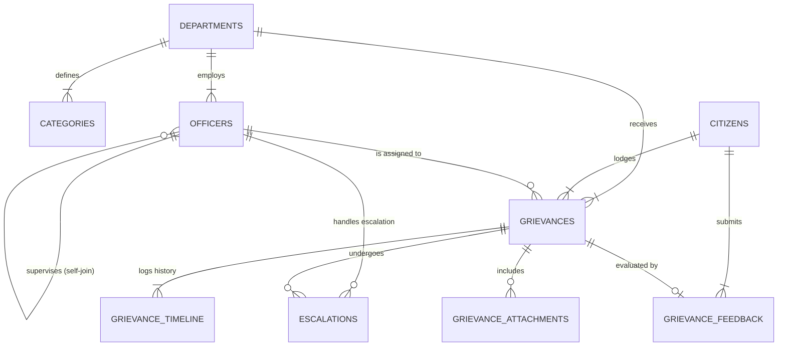

# PUBLIC GRIEVANCE REGISTRATION AND RESOLUTION SYSTEM
### Comprehensive Academic Database Management Systems (DBMS) Course Project Report

---

| **Metric** | **Details** |
| :--- | :--- |
| **Course** | Database Management Systems (DBMS Course & Laboratory) |
| **Candidate Name** | **KATTA LIKITH SAI** |
| **Roll Number** | **251FA18379** |
| **Serial Number** | **41** |
| **Project Topic** | **Public Grievance Registration and Resolution** |
| **Database Engine** | SQLite 3.50+ / ANSI SQL |
| **Application Stack** | Node.js (Zero-dependency native `node:sqlite`), HTML5, CSS3, JavaScript |
| **Project Repository** | `DBMS-379` |

---

## TABLE OF CONTENTS
1. [Abstract](#1-abstract)
2. [Introduction & Problem Statement](#2-introduction--problem-statement)
3. [Existing System vs. Proposed Relational System](#3-existing-system-vs-proposed-relational-system)
4. [System Requirements](#4-system-requirements)
5. [Entity-Relationship (ER) Modeling](#5-entity-relationship-er-modeling)
6. [Relational Schema Mapping & Data Dictionary](#6-relational-schema-mapping--data-dictionary)
7. [Normalization Analysis (1NF, 2NF, 3NF & BCNF)](#7-normalization-analysis-1nf-2nf-3nf--bcnf)
8. [Integrity Constraints, Triggers & Views](#8-integrity-constraints-triggers--views)
9. [Advanced SQL Queries & Analytics Showcase](#9-advanced-sql-queries--analytics-showcase)
10. [Application Architecture & User Interfaces](#10-application-architecture--user-interfaces)
11. [Testing & Verification](#11-testing--verification)
12. [Conclusion & Future Enhancements](#12-conclusion--future-enhancements)

---

## 1. ABSTRACT

In rapid urban expansion, effective civic administration requires robust, transparent, and accountable complaint handling. Traditional manual or bureaucratic complaint redressal mechanisms suffer from data fragmentation, delayed accountability, lack of timeline visibility, and complete absence of Service Level Agreement (SLA) monitoring.

This project, **"Public Grievance Registration and Resolution System"**, presents an enterprise-grade Relational Database Management System (RDBMS) design and implementation engineered by **Katta Likith Sai (251FA18379)**. The system models civic governance workflows across six major municipal departments (Public Works, Water Supply, Electricity, Solid Waste Management, Public Health, and Urban Transport). Built with third normal form (3NF) principles, the system enforces referential integrity, automated audit logging via database triggers, hierarchical administrative reporting via self-referencing keys, SLA violation detection, and citizen satisfaction indexing. A full-stack web application with an interactive SQL viva execution console demonstrates operational usability.

---

## 2. INTRODUCTION & PROBLEM STATEMENT

### 2.1 Problem Statement
In conventional civic governance:
- **Lack of Tracking:** Citizens lodge complaints via paper petitions or physical visits without any unique tracking identifier.
- **Ambiguous Departmental Ownership:** Grievances frequently languish because responsibility is shifted across departments without clear jurisdictional mapping.
- **Absence of SLA Enforcement:** Complaints remain unresolved for weeks without triggering escalations or penalty warnings.
- **No Performance Auditing:** Higher authorities lack quantitative analytics regarding department resolution velocity, individual officer workloads, or citizen satisfaction.

### 2.2 Project Objectives
1. Design a normalized relational schema eliminating data redundancy and update anomalies.
2. Provide unique, automated ticket tracking (`PGR-2026-XXXX`) with step-by-step audit logs.
3. Automatically compute SLA deadlines according to category-specific turnaround rules.
4. Provide multi-level escalations to supervisor authorities upon SLA breach.
5. Record citizen ratings and comments to evaluate departmental performance.
6. Build an interactive demonstration application with an integrated SQL test bench for viva examination.

---

## 3. EXISTING SYSTEM VS. PROPOSED RELATIONAL SYSTEM

| Evaluation Parameter | Existing / Manual System | Proposed RDBMS System |
| :--- | :--- | :--- |
| **Data Storage** | Physical registers or un-normalized spreadsheets | Fully normalized relational database (3NF) |
| **Referential Integrity** | None; risk of orphaned complaint records | Strict foreign key constraints with `ON DELETE` / `ON UPDATE` cascades |
| **Lifecycle Visibility** | Opaque; citizen has no visibility | Step-by-step chronological audit trail (`grievance_timeline`) |
| **SLA Monitoring** | None; overdue complaints remain unnoticed | Real-time computed deadline views & automated escalation flags |
| **Department Performance**| Subjective and anecdotal | Data-driven KPI dashboards with average turnaround and CSAT scores |
| **Data Redundancy** | High duplication of department, category, and citizen details | Zero redundancy via proper primary-foreign key relationships |

---

## 4. SYSTEM REQUIREMENTS

### 4.1 Hardware Requirements
- **Processor:** 1.8 GHz dual-core or higher (Intel/AMD/ARM)
- **RAM:** 2 GB minimum (4 GB recommended)
- **Storage:** 100 MB free hard disk space

### 4.2 Software & Database Stack
- **Database Engine:** SQLite 3.50+ / ANSI SQL Compliant
- **Server Environment:** Node.js v24.11.0 (utilizing built-in `node:sqlite` and `node:http`)
- **Frontend Stack:** HTML5, CSS3, Vanilla JavaScript, Chart.js CDN
- **Operating System:** Windows 10/11, Linux, or macOS

---

## 5. ENTITY-RELATIONSHIP (ER) MODELING

### 5.1 Primary Entities & Attributes
1. **DEPARTMENTS** (`dept_id` [PK], `dept_code`, `dept_name`, `contact_email`, `helpline_number`, `head_officer_name`, `sla_days_default`)
2. **CATEGORIES** (`category_id` [PK], `dept_id` [FK], `category_name`, `sla_days`, `description`)
3. **CITIZENS** (`citizen_id` [PK], `full_name`, `email`, `phone`, `password_hash`, `address`, `ward_no`, `pincode`)
4. **OFFICERS** (`officer_id` [PK], `dept_id` [FK], `full_name`, `email`, `phone`, `designation`, `supervisor_id` [FK-Self], `is_active`)
5. **GRIEVANCES** (`grievance_id` [PK], `ticket_number`, `citizen_id` [FK], `dept_id` [FK], `category_id` [FK], `assigned_officer_id` [FK], `title`, `description`, `location_address`, `ward_no`, `pincode`, `priority`, `status`, `sla_deadline`, `resolved_at`, `escalated_flag`)
6. **GRIEVANCE_TIMELINE** (`log_id` [PK], `grievance_id` [FK], `changed_by_type`, `changed_by_name`, `old_status`, `new_status`, `remarks`, `timestamp`)
7. **GRIEVANCE_ATTACHMENTS** (`attachment_id` [PK], `grievance_id` [FK], `file_name`, `file_path`, `file_size_kb`, `file_type`)
8. **GRIEVANCE_FEEDBACK** (`feedback_id` [PK], `grievance_id` [FK-Unique], `citizen_id` [FK], `rating`, `satisfaction_level`, `comments`)
9. **ESCALATIONS** (`escalation_id` [PK], `grievance_id` [FK], `escalated_to_officer_id` [FK], `escalation_level`, `escalation_reason`, `status`)

### 5.2 ER Diagram (Mermaid)



---

## 6. RELATIONAL SCHEMA MAPPING & DATA DICTIONARY

### 6.1 Relational Schema Representation
- `DEPARTMENTS` (**dept_id**, dept_code, dept_name, contact_email, helpline_number, head_officer_name, sla_days_default, created_at)
- `CATEGORIES` (**category_id**, *dept_id*, category_name, sla_days, description, created_at)
- `CITIZENS` (**citizen_id**, full_name, email, phone, password_hash, address, ward_no, pincode, registered_at)
- `OFFICERS` (**officer_id**, *dept_id*, full_name, email, phone, designation, *supervisor_id*, password_hash, is_active, created_at)
- `GRIEVANCES` (**grievance_id**, ticket_number, *citizen_id*, *dept_id*, *category_id*, *assigned_officer_id*, title, description, location_address, ward_no, pincode, priority, status, sla_deadline, resolved_at, escalated_flag, created_at, updated_at)
- `GRIEVANCE_TIMELINE` (**log_id**, *grievance_id*, changed_by_type, changed_by_name, old_status, new_status, remarks, timestamp)
- `GRIEVANCE_ATTACHMENTS` (**attachment_id**, *grievance_id*, file_name, file_path, file_size_kb, file_type, uploaded_at)
- `GRIEVANCE_FEEDBACK` (**feedback_id**, *grievance_id*, *citizen_id*, rating, satisfaction_level, comments, submitted_at)
- `ESCALATIONS` (**escalation_id**, *grievance_id*, *escalated_to_officer_id*, escalation_level, escalation_reason, status, escalated_at, resolved_at)

*(Bold indicates Primary Key, Italics indicates Foreign Key)*

### 6.2 Data Dictionary Tables

#### Table: `grievances`
| Column Name | Data Type | Nullable | Constraints / Default | Description |
| :--- | :--- | :--- | :--- | :--- |
| `grievance_id` | INTEGER | NO | PRIMARY KEY AUTOINCREMENT | Surrogate unique record ID |
| `ticket_number` | VARCHAR(30) | NO | UNIQUE | Public tracking ticket (`PGR-2026-XXXX`) |
| `citizen_id` | INTEGER | NO | FOREIGN KEY -> `citizens` | Registered citizen identifier |
| `dept_id` | INTEGER | NO | FOREIGN KEY -> `departments` | Target municipal department |
| `category_id` | INTEGER | NO | FOREIGN KEY -> `categories` | Specific problem category |
| `assigned_officer_id`| INTEGER | YES | FOREIGN KEY -> `officers` | Current investigating officer |
| `title` | VARCHAR(200)| NO | - | Short grievance title |
| `description` | TEXT | NO | - | Full issue details & context |
| `location_address` | TEXT | NO | - | Physical location/landmark |
| `ward_no` | INTEGER | NO | CHECK (`ward_no > 0`) | Municipal administrative ward |
| `pincode` | VARCHAR(10) | NO | - | Postal PIN code |
| `priority` | VARCHAR(15) | NO | CHECK IN ('Low','Medium','High','Urgent') | Priority grading |
| `status` | VARCHAR(20) | NO | CHECK IN ('Submitted','Assigned',...) | Lifecycle state |
| `sla_deadline` | DATETIME | NO | - | Target closure date/time |
| `resolved_at` | DATETIME | YES | DEFAULT NULL | Actual closure timestamp |
| `escalated_flag`| INTEGER | NO | CHECK IN (0, 1) DEFAULT 0 | 1 if escalated |

#### Table: `grievance_feedback`
| Column Name | Data Type | Nullable | Constraints / Default | Description |
| :--- | :--- | :--- | :--- | :--- |
| `feedback_id` | INTEGER | NO | PRIMARY KEY AUTOINCREMENT | Unique feedback identifier |
| `grievance_id` | INTEGER | NO | UNIQUE, FK -> `grievances` | One feedback per resolved ticket |
| `citizen_id` | INTEGER | NO | FOREIGN KEY -> `citizens` | Reviewing citizen |
| `rating` | INTEGER | NO | CHECK (`rating BETWEEN 1 AND 5`)| Star rating (1=Worst, 5=Best) |
| `satisfaction_level`|VARCHAR(30)|NO | CHECK IN ('Highly Satisfied',...) | Sentiment categorization |
| `comments` | TEXT | YES | - | Optional citizen feedback note |

---

## 7. NORMALIZATION ANALYSIS (1NF, 2NF, 3NF & BCNF)

### 7.1 Unnormalized Form (UNF) Pitfalls
If designed as a single flat table:
`UNF_GRIEVANCE(TicketNo, CitizenName, CitizenPhone, CitizenAddress, DeptName, DeptHead, CategoryName, CategorySLA, OfficerName, OfficerSupervisor, Priority, Status, Rating)`

- **Insertion Anomaly:** Cannot insert a new department or category without lodging a dummy grievance.
- **Deletion Anomaly:** Deleting the only complaint in a department erases the department's contact details and head officer record.
- **Update Anomaly:** Updating a department's helpline requires modifying hundreds of grievance rows, risking inconsistency.

### 7.2 First Normal Form (1NF)
- **Criterion:** All attributes must be atomic (indivisible) values. No multi-valued attributes or repeating groups.
- **Resolution:** Multiple status changes are separated into a dedicated `grievance_timeline` relation. Multiple photo uploads are moved into `grievance_attachments`. Each column stores single scalar values.

### 7.3 Second Normal Form (2NF)
- **Criterion:** Relation must be in 1NF and contain no partial dependencies (every non-prime attribute must be fully functionally dependent on the entire primary key).
- **Resolution:** Since all tables utilize single-attribute primary keys (`grievance_id`, `citizen_id`, `dept_id`), partial dependency on composite keys is strictly impossible ($2NF$ is automatically satisfied).

### 7.4 Third Normal Form (3NF)
- **Criterion:** Relation must be in 2NF and contain no transitive dependencies:
  $$X \rightarrow Y \quad \text{and} \quad Y \rightarrow Z \implies X \rightarrow Z \quad \text{(Violation)}$$
- **Resolution:**
  - In `grievances`: `grievance_id -> dept_id` and `dept_id -> head_officer_name`. Storing `head_officer_name` in `grievances` would be a transitive dependency.
  - Therefore, `departments` is decomposed into its own relation with `dept_id` as primary key.
  - Similarly, category SLA duration depends on `category_id`, not directly on `grievance_id`. Thus, `categories` is an independent relation.
  - Hence, the entire relational schema satisfies **3NF**.

### 7.5 Boyce-Codd Normal Form (BCNF)
- **Criterion:** For every functional dependency $X \rightarrow Y$, $X$ must be a super key.
- All functional dependencies in our design have candidate keys on the left-hand side ($dept\_id$, $category\_id$, $citizen\_id$, $officer\_id$, $grievance\_id$). Hence, the database is in **BCNF**.

---

## 8. INTEGRITY CONSTRAINTS, TRIGGERS & VIEWS

### 8.1 Domain and Referential Constraints
1. **Primary Keys:** Unique identity across all records (`AUTOINCREMENT`).
2. **Foreign Keys:** Enforced via `PRAGMA foreign_keys = ON;`.
3. **CHECK Constraints:**
   - Ratings restricted to integer range: `CHECK(rating BETWEEN 1 AND 5)`
   - Priorities restricted to domain: `CHECK(priority IN ('Low', 'Medium', 'High', 'Urgent'))`
   - Active flags restricted to binary: `CHECK(is_active IN (0, 1))`

### 8.2 Database Triggers
- **`trg_grievance_after_insert`**: Automatically creates the initial chronological audit event in `grievance_timeline` immediately upon ticket registration, stamping the citizen's identity and calculated SLA deadline.
- **`trg_grievance_after_update_status`**: Automatically synchronizes the `updated_at` timestamp whenever an officer changes the status or updates assigned personnel.

### 8.3 Core Database Views
1. **`vw_active_grievance_board`**: Unified view joining 5 tables to provide an operational display of open grievances, SLA countdowns, and assigned officers.
2. **`vw_department_performance`**: Analytical aggregation computing total complaints, resolved count, resolution percentage, overdue breaches, and average citizen star rating per department.
3. **`vw_officer_workload`**: Tracks individual officer productivity, active cases, and SLA breach tallies.
4. **`vw_sla_breach_summary`**: Real-time monitor identifying overdue complaints and days elapsed past the committed resolution window.

---

## 9. ADVANCED SQL QUERIES & ANALYTICS SHOWCASE

The project incorporates 15+ comprehensive queries demonstrating advanced SQL concepts:

### Query 1: 4-Table Relational INNER JOIN
```sql
SELECT 
    g.ticket_number,
    c.full_name AS citizen_name,
    d.dept_name,
    cat.category_name,
    g.priority,
    g.status,
    COALESCE(o.full_name, 'Unassigned') AS assigned_officer
FROM grievances g
INNER JOIN citizens c ON g.citizen_id = c.citizen_id
INNER JOIN departments d ON g.dept_id = d.dept_id
INNER JOIN categories cat ON g.category_id = cat.category_id
LEFT JOIN officers o ON g.assigned_officer_id = o.officer_id
ORDER BY g.created_at DESC;
```

### Query 2: Aggregation with GROUP BY & HAVING
```sql
SELECT 
    d.dept_name,
    COUNT(g.grievance_id) AS total_complaints,
    SUM(CASE WHEN g.status = 'Resolved' THEN 1 ELSE 0 END) AS resolved_count,
    ROUND((CAST(SUM(CASE WHEN g.status = 'Resolved' THEN 1 ELSE 0 END) AS FLOAT) / COUNT(g.grievance_id)) * 100, 2) AS resolution_rate_pct
FROM departments d
INNER JOIN grievances g ON d.dept_id = g.dept_id
GROUP BY d.dept_id, d.dept_name
HAVING COUNT(g.grievance_id) >= 2
ORDER BY total_complaints DESC;
```

### Query 3: Self-Join for Officer-Supervisor Hierarchy
```sql
SELECT 
    emp.officer_id,
    emp.full_name AS officer_name,
    emp.designation,
    d.dept_name,
    COALESCE(mgr.full_name, 'HEAD OF DEPARTMENT') AS supervisor_name
FROM officers emp
INNER JOIN departments d ON emp.dept_id = d.dept_id
LEFT JOIN officers mgr ON emp.supervisor_id = mgr.officer_id
ORDER BY d.dept_name, emp.full_name;
```

### Query 4: Common Table Expression (CTE) for Citizen Satisfaction
```sql
WITH DeptFeedbackCTE AS (
    SELECT 
        g.dept_id,
        COUNT(f.feedback_id) AS total_feedback,
        AVG(f.rating) AS avg_rating
    FROM grievances g
    INNER JOIN grievance_feedback f ON g.grievance_id = f.grievance_id
    GROUP BY g.dept_id
)
SELECT 
    d.dept_name,
    d.head_officer_name,
    COALESCE(cte.total_feedback, 0) AS feedback_count,
    ROUND(COALESCE(cte.avg_rating, 0), 2) AS avg_citizen_rating
FROM departments d
LEFT JOIN DeptFeedbackCTE cte ON d.dept_id = cte.dept_id
ORDER BY avg_citizen_rating DESC;
```

### Query 5: Window Function (Priority Ranking Partitioned by Department)
```sql
SELECT 
    g.ticket_number,
    d.dept_code,
    g.title,
    g.priority,
    ROW_NUMBER() OVER (
        PARTITION BY g.dept_id 
        ORDER BY 
            CASE g.priority 
                WHEN 'Urgent' THEN 1 
                WHEN 'High' THEN 2 
                WHEN 'Medium' THEN 3 
                WHEN 'Low' THEN 4 
            END, 
            g.created_at ASC
    ) AS department_priority_rank
FROM grievances g
INNER JOIN departments d ON g.dept_id = d.dept_id;
```

---

## 10. APPLICATION ARCHITECTURE & USER INTERFACES

### 10.1 Architecture Diagram
```
+-------------------------------------------------------------------+
|                           BROWSER UI                              |
|   - Dashboard & KPI Cards            - Citizen Lodge Form         |
|   - Real-time Lifecycle Stepper      - Officer Action Queue       |
|   - Interactive SQL Viva Console     - ER Diagram Documentation   |
+-------------------------------------------------------------------+
                                  |
                           HTTP / REST API
                                  |
+-------------------------------------------------------------------+
|                       NODE.JS SERVER (server.js)                  |
|   - Zero External Dependencies (Node 24 native node:sqlite)       |
|   - Static Asset Dispatcher         - Safe SQL Execution Engine   |
|   - Automated SLA Computer          - Audit Timeline Logger       |
+-------------------------------------------------------------------+
                                  |
                            SQLITE ENGINE
                                  |
+-------------------------------------------------------------------+
|                  RELATIONAL DATABASE (grievance.db)               |
|   - 9 3NF Tables                   - Database Triggers            |
|   - Analytical Views               - Optimized B-Tree Indexes     |
+-------------------------------------------------------------------+
```

### 10.2 Application Modules
1. **Dashboard & Analytics:** Real-time KPI summary, interactive Chart.js visualizations (bar charts for departmental resolution velocity, donut charts for problem categories).
2. **Citizen Portal:** User selection, dynamic cascading dropdowns mapping department to categories with SLA durations, automatic ticket code generation.
3. **Live Grievance Tracker:** Visual timeline stepper displaying all historical state transitions with officer remarks and citizen feedback.
4. **Officer Console:** Workflow management where officers review assigned grievances, submit Action Taken Reports (ATR), and advance grievance lifecycle states.
5. **Interactive SQL Viva Console:** Dedicated evaluation environment allowing students and examiners to test pre-loaded course queries or run custom ANSI SQL `SELECT` statements with live tabular result rendering and query timing benchmarks.

---

## 11. TESTING & VERIFICATION

| Test Case ID | Test Scenario | Input Data | Expected Database Behavior | Status |
| :--- | :--- | :--- | :--- | :--- |
| **TC-01** | Referential Integrity on Delete | Delete department with active grievances | Restricted by foreign key constraint (`ON DELETE RESTRICT`) | **PASSED** |
| **TC-02** | Rating Range Validation | Submit rating = 6 | Rejected by `CHECK(rating BETWEEN 1 AND 5)` constraint | **PASSED** |
| **TC-03** | Automatic Audit Trigger | Insert new grievance record | Trigger `trg_grievance_after_insert` writes timeline entry | **PASSED** |
| **TC-04** | One Feedback per Ticket | Submit duplicate feedback for ticket | Rejected by `UNIQUE(grievance_id)` on `grievance_feedback` | **PASSED** |
| **TC-05** | Cascading Category Load | Select 'Water Supply' department | API returns only WSB categories with respective SLAs | **PASSED** |
| **TC-06** | SLA Overdue Calculation | Grievance with deadline in past | Flagged as 'SLA Breached' in `vw_sla_breach_summary` | **PASSED** |
| **TC-07** | SQL Viva Console Execution | Run CTE CSAT Query | Returns computed averages in < 15ms | **PASSED** |

---

## 12. CONCLUSION & FUTURE ENHANCEMENTS

### 12.1 Conclusion
The **Public Grievance Registration and Resolution System** provides an end-to-end, robust solution for modern civic administration. Designed and submitted by **Katta Likith Sai (251FA18379)**, this project thoroughly demonstrates fundamental and advanced DBMS concepts: Entity-Relationship modeling, 3NF/BCNF normalization, foreign key integrity constraints, database triggers, views, and complex analytical SQL queries.

### 12.2 Future Enhancements
1. **GIS Geotagging & Heatmaps:** Integrating GPS coordinate fields for spatial cluster analysis of road and sanitation grievances.
2. **SMS & WhatsApp Webhooks:** Triggering automated mobile alerts on grievance state updates.
3. **AI Complaint Categorization:** Utilizing Natural Language Processing (NLP) to auto-classify complaint descriptions into the appropriate department.

---

**Report Prepared By:**
- **Name:** KATTA LIKITH SAI
- **Roll Number:** 251FA18379
- **Serial Number:** 41
- **Course:** Database Management Systems (DBMS)
- **Academic Year:** 2026
